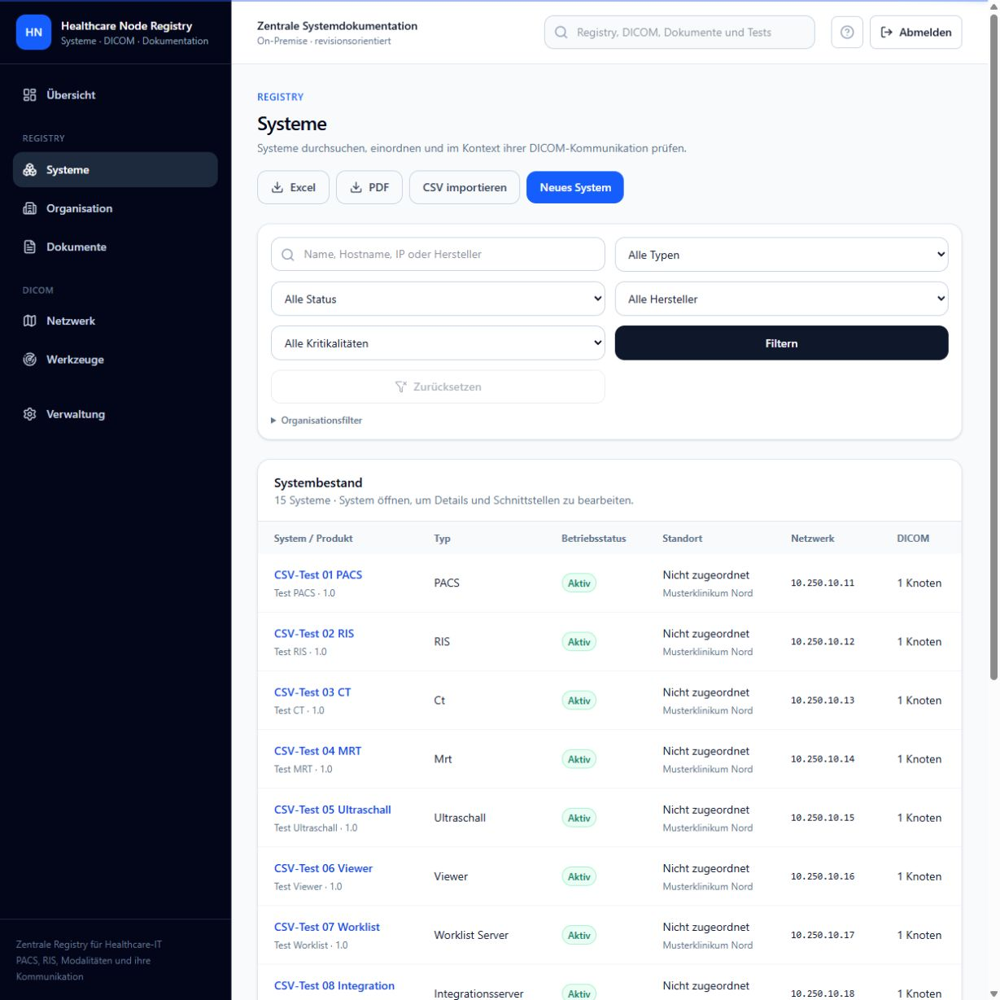
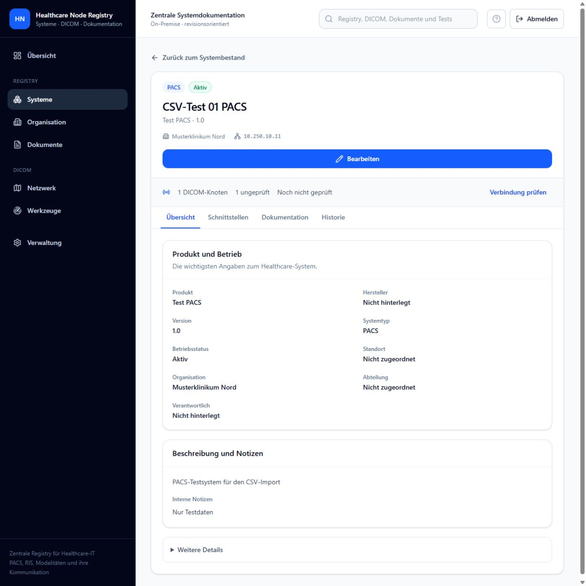

# Systeme und DICOM

## Systeme pflegen

Öffnen Sie **Systeme**, wählen Sie ein System oder legen Sie ein neues an. Pflegen Sie Namen, Typ, Status, Herstellerangaben und Organisationszuordnung nur auf Basis einer belastbaren Quelle. Der System-Workspace bündelt Stammdaten, Dokumentation, DICOM-Knoten und Historie.

## DICOM-Knoten pflegen

Ein DICOM-Knoten beschreibt eine Application Entity mit AE Title, Rolle, Status, Diensten und – soweit vorhanden – einem Netzwerkendpunkt. Prüfen Sie insbesondere:

- AE Title mit maximal 16 Zeichen;
- bei `SCP` oder `SCU & SCP` den im Anwendungscontainer auflösbaren Host beziehungsweise die korrekte IP-Adresse und den tatsächlichen DICOM-Port;
- bei einer reinen `SCU` nur tatsächlich bekannte Endpunktdaten; AE Title allein oder AE Title mit IP-Adresse ist zulässig;
- SCU-/SCP-Rolle je fachlichem Dienst;
- aktiven Status nur für verwendbare Ziele. Technische Diagnosen benötigen immer Host und Port.

## Kommunikationsbeziehungen

Eine Verbindung ordnet Quellknoten, Zielknoten und DICOM-Dienst zu. Sie dokumentiert einen erwarteten Kommunikationsweg, garantiert aber weder Erreichbarkeit noch fachliche Freigabe.

Archivieren Sie veraltete Knoten oder Beziehungen. Nutzen Sie Diagnosefunktionen erst nach Freigabe des Zielsystems. Fachliche Hintergründe stehen in der [DICOM-Referenz](../dicom-reference/README.md).

## Systemansicht

Die Systemansicht hat vier Reiter:

- **Übersicht:** Produkt, Hersteller, Version, Betriebsstatus, Standort und Verantwortlichkeit. Ergänzende technische Angaben wie Betriebssystem, Inventar- und Seriennummer sowie System-ID stehen unter **Weitere Details**.
- **Schnittstellen:** Netzwerkinterfaces, DICOM-Knoten, Kommunikationsverbindungen und Topologie des Systems.
- **Dokumentation:** Strukturierte Betriebsdokumentation und zugehörige Dateien.
- **Historie:** Änderungen und Audit-Ereignisse.

Die kompakte DICOM-Statuszeile fasst Knoten und bisherige Prüfungen zusammen. **Verbindung prüfen** öffnet den Schnittstellenbereich; die konkrete C-ECHO-Prüfung wird dort am gewünschten Knoten gestartet. Beim Wechsel des Systems öffnet sich wieder die Übersicht. Ein HL7-Reiter wird erst mit einer nutzbaren HL7-Funktion angeboten.

## Bestand und Detailseite

Der Systembestand zeigt eine kompakte Tabelle und auf kleinen Bildschirmen eine Liste. Über den Systemnamen öffnet sich eine eigene Detailseite. **Zurück zum Systembestand** führt zur vorherigen Liste einschließlich angewendeter Filter und Seitennummer. Die Seitennavigation erschließt auch Bestände mit mehr als 20 Systemen.

Der DICOM-Prüfstatus unterscheidet erfolgreich geprüfte, fehlgeschlagene, ungeprüfte und nicht per C-ECHO prüfbare Knoten. Ein gespeicherter Erfolg belegt die letzte Prüfung, nicht die aktuelle Erreichbarkeit. Knoten ohne C-ECHO-Unterstützung zählen nicht als erfolgreich geprüft.

## Ansichten

Die folgenden Screenshots zeigen ausschließlich synthetische lokale Beispieldaten:

